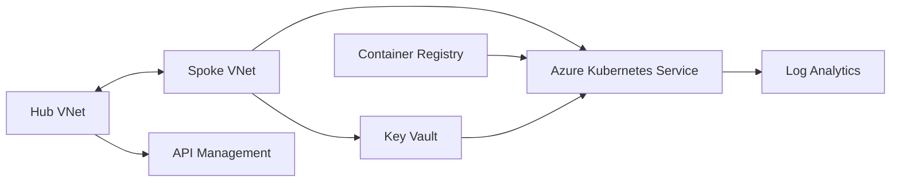

# Azure AKS Platform Blueprint

[](https://developer.hashicorp.com/terraform)
[](https://azure.microsoft.com/)
[](https://ahmed-el-mahdy.github.io/)

A modular Terraform reference for an Azure platform built around AKS, API Management, Azure Container Registry, Key Vault, and hub-spoke networking.

## What This Repository Demonstrates

- Environment composition from small, reusable Terraform modules.
- AKS with managed identity, Azure RBAC, autoscaling, Calico policy, OIDC, Key Vault CSI, Azure Monitor metrics, and Log Analytics.
- Private-by-default Key Vault access with optional private endpoint support.
- ACR integration through an explicit `AcrPull` role assignment.
- APIM network integration with a global rate-limit and CORS policy example.
- Consistent naming and tagging across the platform resources.

## Architecture



The VNet module also reserves hub subnets for Azure Firewall and Application Gateway. Those services are not provisioned by this repository.

## Implemented Modules

| Module | Responsibility |
| --- | --- |
| `modules/vnet` | Hub and spoke VNets, platform subnets, and bidirectional peering |
| `modules/aks` | AKS, system node pool, monitoring, CSI integration, and role assignments |
| `modules/container_registry` | ACR with admin access disabled and optional geo-replication |
| `modules/keyvault` | RBAC-enabled Key Vault and optional private endpoint |
| `modules/api_management` | APIM instance, managed identity, network integration, and global policy |

`environments/dev` is the runnable composition example. `environments/prod/terraform.tfvars` is a production-oriented variable set, not a complete independent root module.

## Repository Structure

```text
.
|-- environments/
|   |-- dev/
|   `-- prod/terraform.tfvars
`-- modules/
    |-- aks/
    |-- api_management/
    |-- container_registry/
    |-- keyvault/
    `-- vnet/
```

## Validate Safely

Prerequisites: Terraform 1.5 or later, Azure CLI, and an authenticated Azure subscription for provider-backed planning.

```bash
terraform fmt -check -recursive
cd environments/dev
terraform init -backend=false
terraform validate
terraform plan -var-file="terraform.tfvars"
```

The plan can create billable Azure resources. Review the variables, naming, SKU choices, and network ranges before any apply operation.

## Important Inputs

The development root expects values for the Azure tenant, AKS administrator group IDs, APIM publisher details, address spaces, node sizing, and private endpoint behavior. Example defaults and environment values are documented in:

- [`environments/dev/variables.tf`](environments/dev/variables.tf)
- [`environments/dev/terraform.tfvars`](environments/dev/terraform.tfvars)
- [`environments/dev/backend.hcl`](environments/dev/backend.hcl)

## Security and Production Notes

- Replace placeholder tenant and identity values before planning.
- Restrict the APIM CORS policy for production workloads; the example currently permits all origins.
- Add policy-as-code, private DNS zones, diagnostic settings, and state-storage bootstrap for a full production platform.
- Use workload identity or federated CI credentials instead of long-lived service-principal secrets.
- Treat the running Azure environment as the source of truth before importing this blueprint into an existing estate.

## Status

This is a portfolio reference implementation. It demonstrates platform composition and security-aware defaults, but it is not a drop-in production landing zone.
